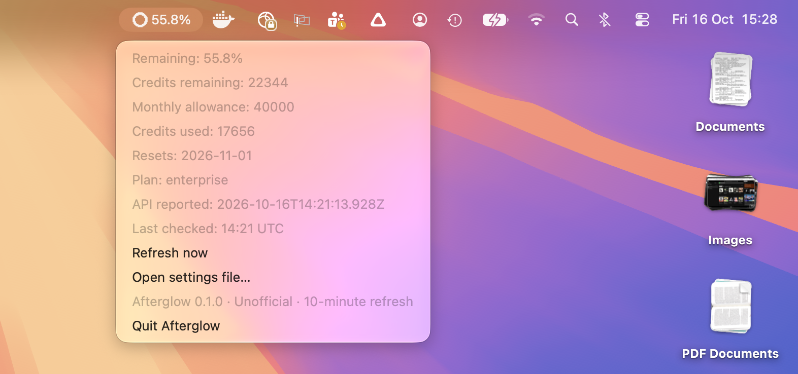

# Afterglow

I made Afterglow because I wanted to see how many Copilot credits I had left
without having to look them up. It sits in your Mac's menu bar or Windows
system tray and uses your existing GitHub CLI login.



**[Download for Mac — Apple Silicon](https://github.com/otherland/afterglow/releases/download/v0.1.0/Afterglow_0.1.0_aarch64.dmg)** ·
**[Download for Windows — x64](https://github.com/otherland/afterglow/releases/download/v0.1.0/Afterglow_0.1.0_x64-setup.exe)**

*Free and open source. Mac download: 3 MB. Windows download: 2 MB.*

> **Early preview:** I've tested it on my Mac with `procode.ghe.com`.
> Windows builds and tests pass, but I haven't tried it on a Windows machine yet.
> Both downloads are unsigned, and the Mac app isn't notarized.
> It relies on an internal GitHub endpoint that could change; other hosts and
> plans haven't been verified.

## What it does

- See remaining credits, allowance, usage, and your next reset date.
- Refreshes every ten minutes, or whenever you choose **Refresh now**.
- Labels your balance **Low** below 20% remaining and **Critical** below 10%.
- Uses your existing `gh auth` login. No token storage, backend, or telemetry.

It's about 500 lines of Rust, including tests, with no frontend JavaScript or
webview window. The numbers are your **monthly account balance**, not usage for
one terminal session. AI credits aren't the same as a count of premium requests.

## Install

**1. Install [GitHub CLI](https://cli.github.com/) and sign in** for your account's
host, if you haven't already:

```sh
gh auth login --hostname YOUR_HOST
```

Replace `YOUR_HOST` with your GitHub hostname, such as `procode.ghe.com`.

**2. Grab the download for your computer using the links above.**

| Platform | Install | Find Afterglow |
|---|---|---|
| macOS 11+, Apple Silicon | Open the DMG; drag Afterglow to Applications | Ring and percentage in the menu bar |
| Windows 10/11, x64 | Run the installer; launch from Start | Right-click the tray ring, possibly under hidden icons |

These previews may trigger Gatekeeper or SmartScreen warnings. Only approve
the app if you trust the download and your organization's policy allows it.
Don't disable system protections. [Help with installation](docs/guide.md#installation-help).

**3. Set your host if needed.** The default is `procode.ghe.com`.
Choose **Open settings file…** from the ring's menu, edit the `hostname` value,
save, and choose **Refresh now**. Your `gh` login must match that host.
Windows shows the percentage inside the menu, not beside the tray icon.

## Building it yourself or having trouble?

[Build from source](docs/guide.md#build-from-source) ·
[Troubleshooting](docs/guide.md#troubleshooting) ·
[How it works](docs/guide.md#how-it-works) ·
[Report an issue](https://github.com/otherland/afterglow/issues)

It doesn't have burn-rate estimates, a model breakdown, notifications, or
launch-at-login yet. GitHub's figures can take a while to catch up, so the menu
shows when the API reported them and when the app last checked.

[MIT licensed](LICENSE). Unofficial; not affiliated with or endorsed by GitHub.
